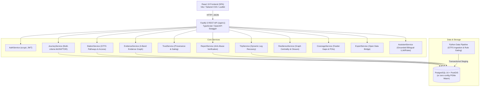
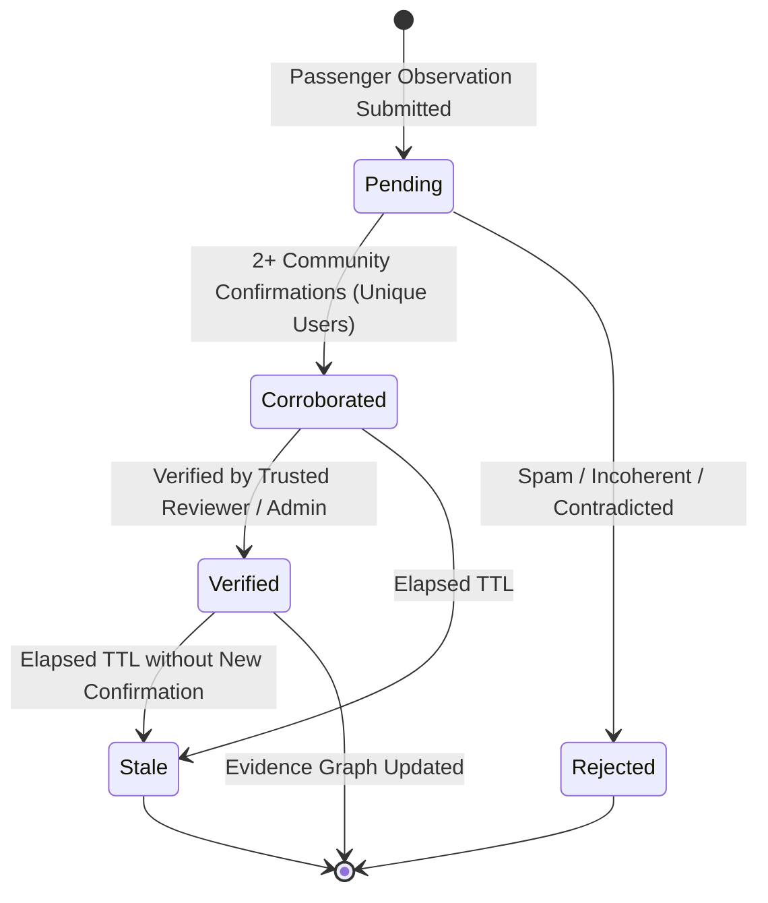

# TransitTrack One — System Architecture Documentation

## 1. Executive Summary

**TransitTrack One** is an evidence-aware multimodal journey planning platform with accessibility routing, community verification, and network resilience analysis designed for Chennai. The system models the four principal transit modes in the Chennai metropolitan area:
- **Chennai Metro Rail Limited (CMRL)** (Blue & Green lines)
- **Metropolitan Transport Corporation (MTC)** (Bus network)
- **Southern Railway Chennai Suburban** (South, West, and North lines)
- **Mass Rapid Transit System (MRTS)** (Beach to Velachery elevated corridor)
- **Pedestrian Connections & GTFS Pathways** (Walking transfers and station step-free paths)

The central architectural contribution is the **Mobility Evidence Graph**, which rates every stop, schedule, and facility across 4 distinct evidence bands: `Verified`, `Likely`, `Uncertain`, and `Unknown`.

---

## 2. Full-Stack Architectural Overview

---

## 3. Database Architecture & Schema Design

The relational schema resides in PostgreSQL with spatial extensions (`PostGIS` geometry / geography) and supports fallback to in-process `@electric-sql/pglite` WebAssembly PostgreSQL.

### Key Relational Entities

1. **`users`**: Secure credentials (scrypt salted hash), roles (`passenger`, `contributor`, `verifier`, `admin`), trust reputation score.
2. **`transit_agencies`**: Operator metadata (`CMRL`, `MTC`, `SR`, `MRTS`).
3. **`data_sources`**: Provenance registry tracking completeness score (0-100), freshness label, license, and validation issues count.
4. **`feed_versions`**: Version history with cryptographic SHA-256 checksums, status (`active`, `staged`, `rejected`, `superseded`), import timestamps, and validation failure JSON summaries.
5. **`stations`**: Canonical stations with PostGIS `POINT(longitude latitude)` coordinates, wheelchair accessibility flag, area name, and foreign key to `evidence_records`.
6. **`facilities`**: Station elevators, escalators, ramps, level platforms, and tactical paving, each carrying independent evidence bands and operational status.
7. **`routes` & `trips` & `stop_times`**: Timetable routing network supporting trip schedules, sequence order, arrival and departure timestamps.
8. **`pathways`**: GTFS-Pathways graph modeling internal station topology: stairs, walkways, elevators, ramps, duration, and traversal difficulty.
9. **`evidence_records`**: Provenance metadata for any network entity: source tier, confidence score (0-1), evidence band (`Verified`, `Likely`, `Uncertain`, `Unknown`), confirmation count, verification timestamp, and rationale.
10. **`validation_findings`**: Issues logged by the ingestion validator (e.g., expired calendars, placeholder timestamps, missing coordinates).
11. **`community_reports`**: Passenger observations (`Broken lift`, `Inaccurate schedule`, `Missing ramp`, `Crowding`, `Entrance closed`), status (`Pending`, `Corroborated`, `Verified`, `Rejected`, `Stale`).
12. **`report_confirmations`**: Anti-abuse community corroboration voting ensuring 1 confirmation per user per report.
13. **`verification_decisions`**: Audit log of verifier/admin decisions promoting or rejecting reports and propagating updates to the evidence graph.
14. **`saved_trips`**: User journey shelf for offline access and dynamic disruption recovery.
15. **`resilience_scenarios`**: Predefined or user-defined network closures (station, transfer, edge) storing baseline vs. disrupted reachability metrics.
16. **`coverage_analysis`**: Feeder gap indices, isochrone walking thresholds, and access ratings.
17. **`export_jobs`**: Open Data Bridge export audit trail (format, payload, eligible report id, author).

---

## 4. Multi-Criteria Timetable Routing (McRAPTOR)

The routing engine implements Round-Based Public Transit Routing (RAPTOR) extended for multi-criteria optimization:
- **Optimization Criteria:**
  1. Earliest arrival time ($\tau$)
  2. Number of transfers ($k$)
  3. Total walking distance / duration ($w$)
  4. Accessibility penalty (stairs vs. lifts)
  5. Minimum evidence band score
- **Weakest-Link Aggregation:** The evidence band of any multimodal itinerary is the weakest band across all traversed segments and transfers:
  $$\text{Itinerary Band} = \min_{leg \in \text{legs}} (\text{Leg Band})$$
- **Disruption Filtering:** Closed stations or edges registered in active resilience scenarios are removed from the timetable graph during round traversal.

---

## 5. Community Verification & Anti-Abuse Lifecycle

1. **Submission:** Report submitted with station, category, description, and optional attachment metadata.
2. **Anti-Abuse Gating:**
   - Same user cannot confirm their own report.
   - Users cannot confirm the same report twice (`UNIQUE(report_id, user_id)` constraint).
   - Rate limiting on submissions prevents flooding.
3. **Corroboration Threshold:** Reaching 2 confirmations automatically promotes the report to `Corroborated`.
4. **Verification & Evidence Propagation:** When marked `Verified`, `EvidenceService.updateFacilityEvidence()` updates the corresponding station facility in the mobility evidence graph, altering the journey planning engine's recommendations.

---

## 6. Bilingual Mobility Assistant Architecture

The assistant provides grounded mobility answers in Tamil and English with zero unsupported claims:
- **Architecture:** Rule-based routing engine with structured tool calling fallback:
  - `checkStationAccess(station)`: queries facility evidence for elevators/ramps.
  - `findJourney(origin, destination, profile)`: queries McRAPTOR timetable engine.
  - `explainEvidence(band, entity)`: queries provenance record and explains reasons for uncertainty.
- **Truthfulness Boundary:** The assistant refuses to make claims regarding live train tracking or unverified facilities, providing explicit guidance on where uncertainty exists.
