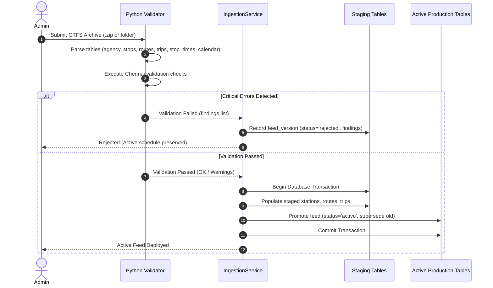

# TransitTrack One — Transit Data Pipeline Documentation

## 1. Overview

Transit data in Chennai is published across disparate schedules with variable quality. The TransitTrack One data ingestion pipeline is written in Python (`data-pipeline/validator.py`) and integrated into Node.js via `IngestionService` (`server/src/services/ingestionService.ts`).

The pipeline enforces strict **Quality Gating**: candidate feeds are validated and staged in isolated database transactions. Feeds that fail critical validation rules are logged as `rejected` with detailed findings, and **never corrupt active production data**.

---

## 2. Ingestion & Gating Architecture



---

## 3. Chennai-Specific Validation Rules

The validator implements domain rules tailored to Chennai public transport:

| Rule Code | Severity | Description | Domain Rationale |
|:---|:---|:---|:---|
| `CHENNAI_CALENDAR_EXPIRED` | `ERROR` | `calendar.txt` end date is earlier than today's date | CMRL and Southern Railway often publish dated special timetables. Expired calendars cause misleading route planning. |
| `CHENNAI_MTC_PLACEHOLDER_TIME` | `ERROR` | `stop_times.txt` departure time is `00:00:15` or constant offset | MTC bus data historically contained placeholder departure seconds (`00:00:15`, `00:00:30`) rather than true headway/frequency or scheduled stops. |
| `CHENNAI_MISSING_COORDINATES` | `ERROR` | Stop coordinate is missing or outside Chennai bounding box ($[12.80^\circ, 13.35^\circ \text{N}]$, $[79.95^\circ, 80.35^\circ \text{E}]$) | Stops with invalid lat/lng break map spatial indexing and distance calculations. |
| `CHENNAI_BROKEN_REFERENTIAL_INTEGRITY` | `ERROR` | `stop_times.stop_id` or `trips.route_id` references non-existent parent ID | Referential breaks crash timetable round algorithms. |
| `CHENNAI_UNKNOWN_ACCESSIBILITY` | `WARNING` | `wheelchair_boarding` is empty or missing from `stops.txt` | Per our core principle, missing access information must be assigned `Unknown` evidence rather than assumed accessible. |

---

## 4. Test Suite & Verification

The pipeline has a dedicated automated Python test suite: `data-pipeline/test_pipeline.py`.

### Test Cases
1. `test_valid_feed`: Verifies that a valid feed with full stops, routes, trips, calendar, and pathways passes with status `PASSED`.
2. `test_expired_calendar`: Verifies that a feed with calendar ending in 2024 is rejected with error code `CHENNAI_CALENDAR_EXPIRED`.
3. `test_mtc_placeholder_times`: Verifies that a feed with `00:00:15` placeholder departures is rejected with error code `CHENNAI_MTC_PLACEHOLDER_TIME`.
4. `test_broken_referential_integrity`: Verifies that stop times referencing non-existent stop IDs are rejected with `CHENNAI_BROKEN_REFERENTIAL_INTEGRITY`.
5. `test_unknown_accessibility_warning`: Verifies that missing accessibility attributes generate an informative `WARNING` and classify station records into the `Unknown` evidence band.

### Execution Command
```sh
python data-pipeline/test_pipeline.py
```
Output:
```
.....
----------------------------------------------------------------------
Ran 5 tests in 0.010s

OK
```
